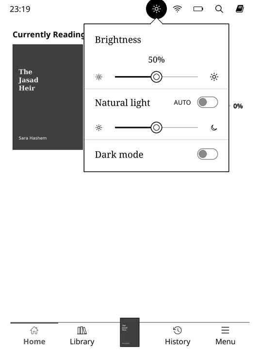
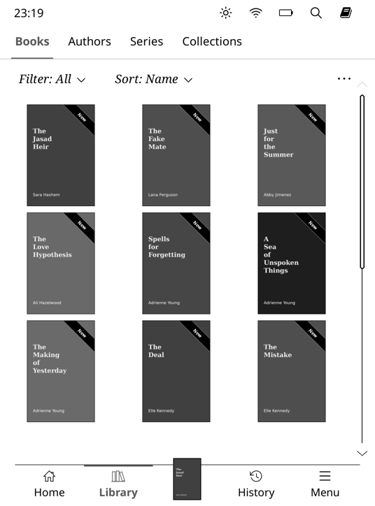
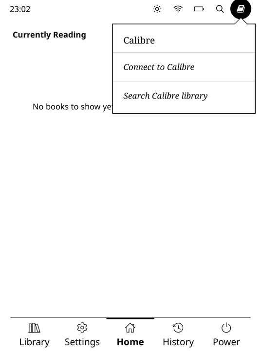
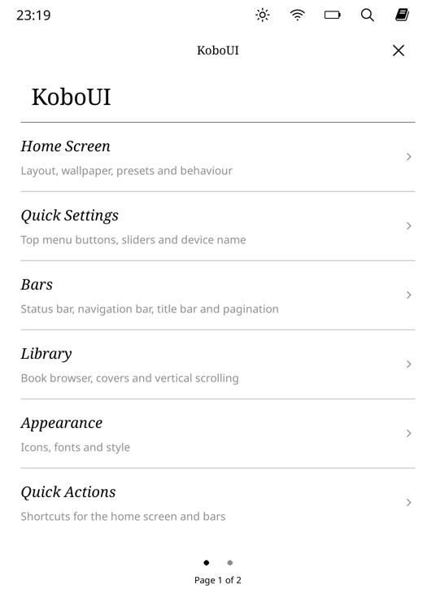

# KoboUI

**A Kobo-style interface for [KOReader](https://github.com/koreader/koreader).**
A Home screen with modules, Kobo's status bar with drop-down panels, Kobo's "My Books" library with
Books / Authors / Series / Collections tabs, a bottom navigation bar with the book you're reading,
and Kobo-style settings pages — all of it customisable.

Made for Kobo e-readers (colour screens included), and works on any device KOReader runs on.

  
  
  
  

*Screenshots are from the KOReader emulator with sample books.*

---

## Features

- **Kobo status bar** on the Home screen and in the Library: the clock on the left, line icons on
  the right. Tap an icon for its drop-down panel (the icon turns white on a black circle):
  - **Light** — Brightness slider (the % above the knob), Natural light slider (sun → moon) with an
    *AUTO* switch when KOReader's Auto warmth plugin is on, and a Dark mode switch;
  - **Wi-Fi** — *WI-FI: ENABLED* switch, the networks around you (tap one to connect), *Wi-Fi Settings*;
  - **Battery** — "eReader: 33%", *Energy saving settings*, *Battery statistics*;
  - **Sync** — *Sync now* runs the action you choose (for example a sync plugin), with the time of the
    last sync, and *Check for software updates*;
  - **Search** — searches your library.
- **Your own status-bar buttons.** Hide, reorder or re-icon any icon, add your own entries to any
  drop-down, and add buttons of your own (say "Calibre") with a name, an icon, and either one action or
  a drop-down list of entries.
- **Kobo-style Library:** Books / Authors / Series / Collections tabs (Tags optional), then
  **Filter ˅**, **Sort ˅** and **…** menus. Inside an author, series or collection the usual title bar
  with Back comes back.
- **Accent colour:** the current tab is bold and, on a colour screen, Kobo red (or blue, green, purple).
- **Navigation bar** at the bottom, with a **Current Book** tab showing the cover of the book you're
  reading, a **My Books** tab for the Library, a **Menu** tab for KOReader's own menu, and groups.
- **Home screen modules:** Currently Reading, Recent, To Be Read, Featured Collection, Author / Series
  Collection, Two Columns, Reading Calendar, Year in Books, Monthly TBR, Quote, Clock, Reading Goals,
  Reading Stats, Heatmap and more.
- **Library extras:** vertical scrolling with Kobo's scrollbar, a Series bookshelf view, series
  grouping, "last opened" sort, authors sorted by last name, collection shuffle, back to the page you
  were on.
- **Kobo-style settings pages** (serif titles, italic rows).
- **Two fonts, like Kobo:** details in capitals — time left, pages, book counts, module subtitles —
  plus the navigation bar and the Library tabs use a sans-serif **Label Font**; everything else uses
  the UI font. Settings → Style → *Label Font*: by default KOReader's own sans-serif (Noto Sans);
  any installed font can be chosen.
- No "Opening file…" / "Closing book…" popups.

## Requirements

- KOReader (tested with v2026.07). KoboUI is a plugin; nothing in KOReader itself is changed.
- A touch screen.

## Install

1. Download **KoboUI-vX.Y.Z.zip** from the [Releases](../../releases) page.
2. Unzip it. You get a folder named **`KoboUI.koplugin`** (the name must stay exactly that).
3. Copy the folder into KOReader's `plugins/` folder. On a Kobo that is `.adds/koreader/plugins/`.
4. Restart KOReader.

Don't install KoboUI next to **KindleUI**, **SimpleUI** or **vertical_library_scroll**: KoboUI
contains them. If one of them is still enabled, KoboUI switches it off and asks you to restart.
Your SimpleUI / KindleUI Home screen, modules and bars carry over.

## Getting started

- **KoboUI settings:** the **Settings** tab/quick action, KOReader menu → Tools → **KoboUI**, or a
  long press on a module or bar.
- **KOReader's own menu:** swipe down from the top of the screen, put the **Menu** tab in the
  navigation bar, or KoboUI settings → **KOReader Menu**.
- **Home screen layout:** Settings → Home Screen → **Edit Home Screen Layout** → Add Module.
- **Status bar buttons:** KoboUI settings → **Status Bar** (or long-press the status bar).

---

## Status bar

Tap an icon to open its panel; tap it again, or anywhere outside, to close it. Tapping another icon
while a panel is open switches to that panel. Tapping elsewhere in the bar does nothing — swipe down
for KOReader's menu.

**Settings** (KoboUI settings → **Status Bar**, or long-press the status bar). The Kobo status bar
is always on (on the Home screen and in My Books; inside a book KOReader's own screen is
unchanged); there's no separate quick-settings panel — the status bar's buttons are where you add
and remove actions.

- **Buttons** — one page per button: *Show in the status bar*, *Name*, *Icon*, and *Extra drop-down
  entries*.
- **Arrange buttons** — drag your own button where you want it (e.g. where Sync was).
- **Add a custom button** — e.g. "Calibre": name it, and its page opens to choose the icon and
  *When tapped: run an action* (pick it) or *When tapped: open a drop-down* (add its entries).
- **Add a button from KOReader's menu** — long-press any item of KOReader's menu and it becomes a
  button that opens it.
- **Show Battery Percentage** next to the battery icon (the battery is always horizontal).
- **Sync Action** — what *Sync now* does.
- **Clock and Text Items** — the clock on the left (in the label font).

**Icons:** the icon picker's **Line** tab has thin line icons drawn like the status bar's own (same
line thickness); **Symbols** has every symbol of KOReader's icon font, **Images** your own icons.

**Actions** can be any KoboUI action, any KOReader action, or anything in KOReader's menu: choose
*Pick from KOReader's menu (capture)*, go to the item and **long-press** it. A long-pressed submenu (a
plugin under *More tools*, for example) opens KOReader's menu right there.

Bluetooth: KOReader doesn't control Bluetooth on Kobo, so its icon is hidden; show it and give it
entries if you use a Bluetooth plugin.

## Library

- **Tabs:** Books, Authors, Series, Collections (and Tags: **…** → *Show Tags tab*). The Library
  remembers the last tab.
- **Filter:** multiple choice — tick any of Unread, Reading, Finished (e.g. Unread + Reading for
  everything not finished), or All; with counts, like Kobo: *Finished* = marked Finished,
  *Reading* = started (or On hold), *Unread* = never started. It applies to every tab and is
  remembered (the Series bookshelf always shows everything).
- **Sort:** Recent, Date added, Title, Author, Series, File size, File type. On Authors: Last name or
  First name.
- **…:** Cover view / List view (remembered **per tab**: e.g. a list for Authors, covers for Books), Titles
  under covers (per tab), Group series, Reverse order, Bookshelf / Folder view (Series), Manage
  collections (Collections), Show / Hide Tags tab.
- **Kobo list view:** books show the cover, title, pages, series, author, and on the right Unread /
  "19% Read" / Finished, the time left, and the file type and size (long-press a book for its menu). Authors, Series,
  Collections and Tags are a plain list of names with the number of books.
- **Progress under covers:** Settings → Library → Cover Settings → Badges → Progress → Type →
  *Progress text under the cover* shows "19% Read", "Unread" or "Finished" under each book (instead of
  the corner badge); *Text size under the cover*, in the same menu, sets its size.
- **Titles under covers** (Settings → Library → *Titles Under Covers*): choose the tabs that show the
  title or name under each cover — by default Authors, Series, Collections and Tags, not Books.
- **Vertical scrolling** (on by default; Settings → Library): swipe up and down; Kobo's scrollbar on
  the right. The Series bookshelf scrolls sideways.
- **Series bookshelf** (Settings → Library → *Series View Style*): spines on wooden shelves, coloured
  from each cover, the first book of a series face-out.
- **Group series in Books**, **"last opened" sort**, **authors by last name**, **collection shuffle**,
  **back to the page you were on**.

Turn the tabs off under Settings → Library → *Kobo-style Library Tabs*.

## Navigation bar

Settings → Bars → **Navigation Bar**: tabs, tab style (icons, text or both) and sizes.

- **Current Book** shows the cover of the book you're reading, rising just above the bar. Tap it to
  open the book.
- **Menu** opens KOReader's full menu, like Kobo's "More".
- **Groups:** one tab can hold several places and open a small menu (Settings → Quick Actions →
  Create Quick Action → *Group of Quick Actions*).
- The current tab is bold and in the accent colour (Settings → Library → *Accent Colour*).

## Home screen modules

Add them from **Settings → Home Screen → Edit Home Screen Layout → Add Module**; long-press a module
for its settings.

- **Currently Reading** — cover (optional), title, progress and Kobo-style stats ("PAGE 3 OF 10", "5 HOURS TO GO").
- **Featured Collection** and **Author / Series Collection** (shuffles to another author or series).
- **Two Columns** — any two modules side by side.
- **Reading Calendar** — this month, with the books read each day.
- **Year in Books** — the books you finished each month as stacks of covers. Tap a month to see
  its books or **+ Add a book read this month…** (for books read on paper or another e-reader).
- **Monthly TBR** — a to-read checklist per month.
- **And more:** Recent, To Be Read, New Books, Cover Deck, Collections, Quote of the Day, Clock,
  Reading Goals, Reading Stats, Reading Heatmap, Quick Actions, Action List, Spacer.

---

## FAQ

**The plugin doesn't show up.**
The folder must be named exactly `KoboUI.koplugin` and sit directly inside `plugins/`.

**How do I open KOReader's normal menu?**
Swipe down from the top of the Home screen or Library, use the **Menu** tab, or KoboUI settings →
**KOReader Menu**. Inside a book KOReader's menu works as usual.

**Wi-Fi shows "No networks found".**
Wi-Fi has to be on; the list fills in after a few seconds. *Wi-Fi Settings* opens KOReader's own
network menu.

**Where are my settings stored?**
In KOReader's `settings/` folder (`simpleui/sui_settings.lua`). Settings → About KoboUI has backup
and reset.

**Does it update itself?**
No. Download new versions from the Releases page and replace the folder.

## For developers

KoboUI is built on KindleUI (same author), which is built on SimpleUI. The Kobo parts:

| Path | What it is |
| --- | --- |
| `screens/kbo_statusbar.lua` | Status-bar icons, custom buttons, their settings. |
| `screens/kbo_dropdown.lua` | The drop-down panel and its rows (switch, slider, list, link…). |
| `screens/kbo_panels.lua` | Light, Wi-Fi, Bluetooth, Battery, Sync, Search panels. |
| `features/library/kbo_library_header.lua` | Library tabs, Filter / Sort / … row and menus. |
| `infra/kbo_accent.lua` | The accent colour (RGB on colour screens). |
| `icons/kobo/` | The status-bar line icons. |
| `features/kui_topmenu.lua` | Tap on the status bar → panel; swipe down → KOReader menu. |
| `features/kui_vertical_scroll.lua` | Vertical scrolling and the Kobo scrollbar. |

## Credits

- **[SimpleUI](https://github.com/doctorhetfield-cmd)** by doctorhetfield-cmd — the Home screen,
  modules, bars, library features and settings window KoboUI is built on (MIT).
- The Series bookshelf look was inspired by **[Bookshelf](https://github.com/AndyHazz/bookshelf.koplugin)**
  by AndyHazz. KoboUI's shelf is its own code.
- Icon font: Nerd Fonts Symbols, bundled with KOReader.
- **KOReader** and its contributors.

Kobo is a trademark of Rakuten Kobo; Kindle is a trademark of Amazon. KoboUI is an independent project
and isn't affiliated with Rakuten Kobo, Amazon or KOReader.

## License

[MIT](LICENSE). The SimpleUI copyright notice is kept, as its license requires.
